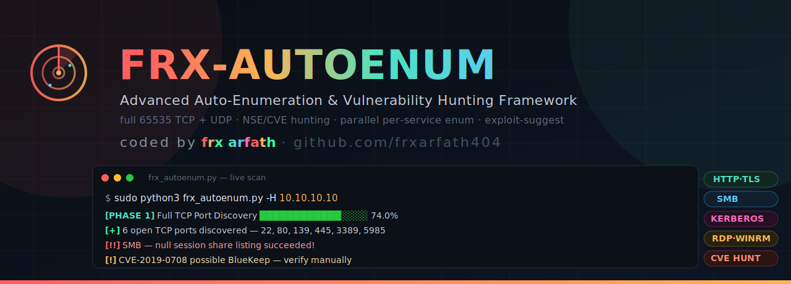

<p align="center">
  
</p>

<p align="center">
  <b>One command. Full recon.</b><br>
  Point it at a target and it runs the entire OSCP-style enumeration checklist for you —
  port scan, service scan, vuln scan, per-service deep enum, exploit suggestions — and
  hands you back one clean report.
</p>

<p align="center">
  
  
  
</p>

<p align="center"><i>coded by <b>frx arfath</b> · <a href="https://github.com/frxarfath404">github.com/frxarfath404</a></i></p>

---

> ⚠️ **Only use this on systems you own or have permission to test (OSCP labs, CTFs, etc).** Using it on anything else is illegal. This tool never auto-exploits anything — it enumerates, fingerprints, and *suggests* candidate exploits for you to review manually.

## What it does

One command runs the whole recon flow, automatically:

1. **Full port discovery** — all 65535 TCP ports scanned
2. **Deep service scan** — version/banner grab on every open port
3. **UDP scan** — top ports (or full range if you want)
4. **Vulnerability scan** — NSE `vuln` + `vulners` scripts, pulls out real CVEs with CVSS scores
5. **Per-service deep enum, in parallel** — HTTP(S)/TLS/CORS/vhost fuzzing, FTP anon-login check, SSH banner, SMB null-session + shares, SNMP, DNS, SMTP user-enum, LDAP anon bind, SQL/Redis/MongoDB no-auth check, NFS exports, RPC, Rsync, RDP (BlueKeep check), WinRM, Kerberos
6. **Exploit-DB cross-reference** — `searchsploit` matched against every detected service version
7. **Auto `/etc/hosts`** — any hostname it discovers (vhosts, cert names, reverse DNS) gets added automatically
8. **One clean Markdown report** — open ports, CVEs by severity, misconfiguration findings, everything

Live progress bars while nmap runs, colour-coded findings, no config needed.

## Install

```bash
git clone https://github.com/frxarfath404/frx-autoenum.git
cd frx-autoenum
pip install -r requirements.txt
chmod +x frx_autoenum.py
```

Needs `nmap` installed (`sudo apt install nmap -y`). Everything else (enum4linux, smbmap, whatweb, nikto, feroxbuster/ffuf/gobuster, searchsploit, etc.) is optional — if a tool isn't installed, that one check is skipped and everything else still runs.

## Make it run from anywhere (optional but handy)

```bash
sudo ln -sf "$(pwd)/frx_autoenum.py" /usr/local/bin/frx-autoenum
```

Now you can just type `frx-autoenum` from any folder.

## How to use it

```bash
# basic — just run it
sudo frx-autoenum -H 10.10.10.10

# custom output folder
sudo frx-autoenum -H 10.10.10.10 -o loot_box1

# skip UDP scan (faster)
sudo frx-autoenum -H 10.10.10.10 --no-udp

# faster/noisier scan (higher min-rate)
sudo frx-autoenum -H 10.10.10.10 --fast

# full 1-65535 UDP scan (slow, thorough)
sudo frx-autoenum -H 10.10.10.10 --udp-full

# custom DNS server + more parallel workers
sudo frx-autoenum -H target.htb -d 10.10.10.10 --threads 16
```

### The main flags you'll actually use

| Flag | What it means |
|---|---|
| `-H` | target IP or hostname (required) |
| `-o` | output folder (default: the target name) |
| `-d` | custom DNS server for lookups |
| `--no-udp` | skip the UDP scan entirely |
| `--udp-ports N` | scan top-N UDP ports (default 1000) |
| `--udp-full` | full 1-65535 UDP scan (very slow) |
| `--fast` | noisier/faster TCP discovery (min-rate 1000) |
| `--threads N` | parallel enum module workers (default 8) |
| `--timeout N` | per-tool timeout in seconds (default 240) |

Run as **root/sudo** — needed for the UDP scan, some NSE scripts, and writing to `/etc/hosts`. It still works without root, just with those bits skipped.

## What you get

```
<output_dir>/
├── FRX-Report_<target>.md     <- the final report: ports, CVEs, findings, exploits
├── nmap/                      <- raw nmap .xml / .nmap / .gnmap for every phase
└── recon/                     <- raw output from every per-service module
```

## Example finding

```
[!!] SMB — null session share listing succeeded!
[!]  CVE-2019-0708 possible BlueKeep — verify manually
[+]  Discovered hostname: dc01.corp.local
```

---

<p align="center">Made for the grind. Good luck on the OSCP. 🐺<br>
<sub>MIT License · © 2026 Mohammed Arfath (frx arfath) · For OSCP / educational use only</sub></p>
